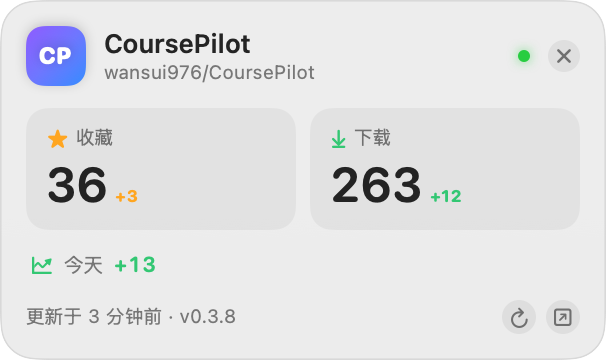
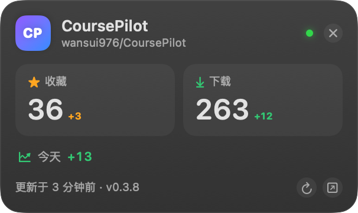

# CoursePilot 数据悬浮窗

一张常驻屏幕右上角的卡片，实时显示 [wansui976/CoursePilot](https://github.com/wansui976/CoursePilot) 的 **star / 下载量**；菜单栏里也有一份同样的数字。

<p>
  
  
</p>

不依赖任何第三方软件，原生 Swift + SwiftUI，一个 1 MB 的菜单栏 App。

---

## 30 秒用起来

```bash
cd tools/coursepilot-stats
./build.sh                      # 需要 Xcode Command Line Tools，编译约 40 秒
open dist/CoursePilotStats.app  # 或者 ./install.sh 装进 /Applications
```

装到「应用程序」里长期用（推荐）：

```bash
./install.sh
```

想让它开机自启：点菜单栏数字 → 打开「开机自动启动」。

## 能做什么

| 交互 | 效果 |
| --- | --- |
| 右上角悬浮卡片 | 只显示收藏和下载两个数字，毛玻璃背景，浅色深色都适配 |
| 拖动卡片 | 位置会被记住，下次启动还在原地 |
| 双击卡片、点 ↗ | 打开 GitHub 仓库 |
| 右键卡片 | 刷新 / 隐藏悬浮窗 / 打开仓库 / 退出 |
| 卡片上的 ↻、✕ | 立即刷新、收起卡片 |
| 点菜单栏 **★ 36 ↓ 263** | 刷新频率（1/5/10/30/60 分钟）、开机自启、显示/隐藏卡片 |
| 数字变化 | 旁边冒出 `+3` 的绿色小角标，5 分钟后自然消失 |
| 每日新增 | 卡片上「今天 +12」这一行，见下面《每天新增多少》 |

细节：卡片是「不抢焦点」的浮动面板，点它不会把你正在用的窗口切到后台；它会跟随所有桌面空间，全屏看视频时也在。

## 数据从哪来

| 数字 | 来源 |
| --- | --- |
| 收藏 | `GET /repos/wansui976/CoursePilot` → `stargazers_count` |
| 下载 | `GET /repos/.../releases` → 所有正式版本里每个资产的 `download_count` 累加（当前 16 个版本） |

注意下载量的口径：**只有 release 里的安装包才算**。git clone、Homebrew / npm 安装、从官网直接下的包都不计入——GitHub 本来也不提供这两个数字。所以它会比"实际用户数"小。

## 每天新增多少？

GitHub **没有**给按天的下载数据。`download_count` 是每个安装包的累计值，没有时间戳，也没有历史序列，翻遍文档只有这几个相邻的东西：

| 想要的 | 能不能拿到 |
| --- | --- |
| 每个安装包的累计下载 | ✅ `GET /repos/{repo}/releases` 里的 `assets[].download_count` |
| 每天新增多少 | ❌ 没有接口，只能自己隔天记一次累计值再相减 |
| 每天 clone / 页面访问 | ⚠️ `GET /repos/{repo}/traffic/clones`、`/traffic/views`：只有**最近 14 天**、要带写权限的 token，而且**不含** release 下载 |

所以 App 自己记账：每次刷新成功，就把「今天 / 累计 N」写进本地存储；第二天起卡片上会多一行「今天 +12」，隔了几天没开机就是「近 3 天 +37」。

两件事得先说清楚：

- **从装上那天开始才有数**，之前的每日分布补不回来（GitHub 根本不记录）；
- App 没运行的那天不会记，那段增量会并到下一次，显示成「近 N 天」。

数据存在 `defaults read com.wansui976.coursepilotstats dailyTotals`，保留 90 天，随手可查可导出。想让历史跟着仓库走、换电脑也不丢，就加一个每天跑一次的 GitHub Action（把总量追加到 `stats/downloads.csv` 再提交）——需要的话说一声。

## 刷新频率与 GitHub 限流

未登录的 GitHub API 每小时只能调 60 次。一次刷新用 2 个请求（仓库信息 + 版本列表），所以：

- 默认 5 分钟一刷 = 每小时 24 次请求，离上限还很远；
- 选 1 分钟一刷 = 每小时 120 次，会撞上限（撞上了卡片会显示「GitHub 限流，xx:xx 后恢复」，数字退回缓存值，不会崩）。

想更快或者更稳，给一个只读 token（5000 次/小时）：

```bash
defaults write com.wansui976.coursepilotstats githubToken "ghp_你的token"
```

也可以 `export GITHUB_TOKEN=...` 后再启动 App。token 只需要 `public_repo` 范围的读权限，不填也完全够用。

另外 GitHub 自己的 star 数有几秒到几十秒的缓存，所以"实时"的粒度实际是分钟级。

**如果你挂着代理 / VPN**，出口 IP 往往是很多人共用的，60 次的那点额度可能几小时就被别人用光，卡片就会显示「GitHub 限流，xx:xx 后恢复」。这种时候配一个自己的只读 token 基本是必须的，配完能到 5000 次/小时。

## 不想装 App？还有两条路

**1. 只要菜单栏（SwiftBar / xbar）**

```bash
brew install --cask swiftbar
mkdir -p ~/Library/Application\ Support/SwiftBar/Plugins
cp swiftbar/coursepilot.5m.sh ~/Library/Application\ Support/SwiftBar/Plugins/
```

脚本里已经写好 5 分钟自动刷新，点开能看到版本号和一键打开仓库。第一次运行 SwiftBar 会让你选插件目录，选上面那个即可。（依赖 `jq`，macOS 15 自带。）

**2. 真正的「小组件」（WidgetKit，通知中心 / 桌面）**

能做，但不适合这个需求，所以这里没做：WidgetKit 的时间线由系统调度，最快也就 15 分钟刷新一次，而且必须单独建一个 Xcode 工程 + Widget Extension、用 App Group 传数据、还要签名才能装。想要"随时一眼看到最新数字"，悬浮窗比系统小组件靠谱。

**3. 零安装的临时方案**：README 里那几个 shields.io 徽章（`img.shields.io/github/stars/...`）本身就是实时数字，放到一个浏览器小窗口里也能看。

## 卸载

```bash
pkill -x CoursePilotStats
rm -rf /Applications/CoursePilotStats.app
rm -f ~/Library/LaunchAgents/com.wansui976.coursepilotstats.plist   # 开过开机自启才有
defaults delete com.wansui976.coursepilotstats
```

## 目录结构

```
coursepilot-stats/
├── Sources/                  Swift 源码（约 900 行）
│   ├── App.swift             @main、菜单栏、菜单内容
│   ├── HUDView.swift         悬浮卡片 UI
│   ├── HUDController.swift   无边框置顶面板、位置记忆
│   ├── AppStore.swift        状态、缓存、定时刷新
│   ├── GitHubClient.swift    GitHub 只读接口
│   ├── LoginItem.swift       开机自启（LaunchAgent）
│   ├── Models.swift          数据类型与格式化
│   ├── PreviewRenderer.swift 离屏渲染，用来检查排版
│   └── Diagnostics.swift     --diagnose 打印屏幕/状态栏实况
├── build.sh                  编译 + 打包 + 自签名
├── install.sh                装到 /Applications
├── make_icon.py              生成 AppIcon.icns
├── swiftbar/                 可选：SwiftBar 插件
└── dist/                     产物
```

开发时两个小工具：

```bash
# 不截屏也能看卡片长什么样（离屏渲染成 PNG）
./dist/CoursePilotStats.app/Contents/MacOS/CoursePilotStats --render-preview /tmp/hud.png

# 打印屏幕尺寸、菜单栏项位置、悬浮窗位置
./dist/CoursePilotStats.app/Contents/MacOS/CoursePilotStats --diagnose
```
